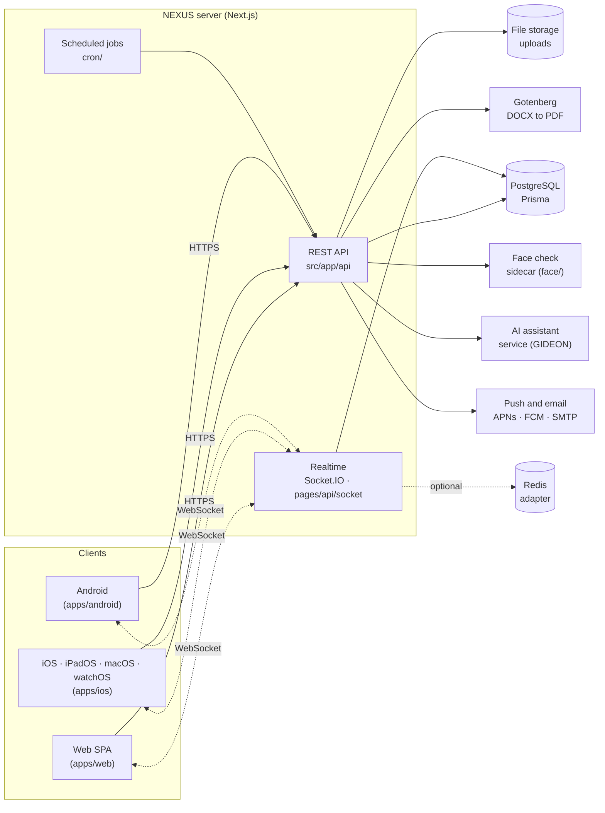

<div align="center">

# NEXUS

**One workspace for a whole group of companies: projects, people, attendance, chat, deals and documents, live on every screen.**

[](#monorepo-layout)
[](#monorepo-layout)
[](#monorepo-layout)
[](#monorepo-layout)
[](#monorepo-layout)

[](https://nextjs.org)
[](https://react.dev)
[](https://www.typescriptlang.org)
[](https://vite.dev)
[](https://tailwindcss.com)
[](https://www.prisma.io)
[](https://www.postgresql.org)
[](https://socket.io)
[](https://developer.apple.com/xcode/swiftui/)
[](https://developer.android.com/compose)

[Features](#features) · [Screenshots](#screenshots) · [Architecture](#architecture) · [Monorepo layout](#monorepo-layout) · [Getting started](#getting-started) · [Tech stack](#tech-stack)

</div>

---

NEXUS is an internal workspace app built for a group of companies that share people, rooms and clients. It
replaces the usual pile of a task tool, a chat app, an attendance spreadsheet, a deal tracker and a shared
drive with one product, one account and one source of truth. Every client talks to the same API, and every
change shows up everywhere in real time.

## Features

<table>
<tr>
<td width="33%" valign="top">

### Attendance
Check in with a **selfie and a liveness check** inside an office **geofence**. Shifts, flexi time, rest days,
leave and permit requests, an approval chart, offline check-in that syncs later, and signals that flag a
faked location instead of silently trusting it.

</td>
<td width="33%" valign="top">

### Projects
Notion-style projects with **board, list, table, calendar and timeline** views, saved views per person,
custom fields (amount, category, people, dates…), subtasks, dependencies, comments and a block editor
with live co-editing.

</td>
<td width="33%" valign="top">

### Forms
Build a request form in minutes, share it, and every submission becomes a task in the right section, with
answers mapped to custom fields and routing rules that pick the assignee.

</td>
</tr>
<tr>
<td valign="top">

### Chat
Direct messages, groups and a room for every project, with replies, mentions, attachments, unread counts,
typing indicators and per-room mute. Built to replace the team group chat.

</td>
<td valign="top">

### GIDEON, the AI assistant
Ask in plain language to find, create or update work, summarise what changed, and get a first pass on
support tickets. Changes it proposes are shown before they apply.

</td>
<td valign="top">

### Z Vault
File storage for the workspace: folders, large chunked uploads, previews, and share links you can revoke.

</td>
</tr>
<tr>
<td valign="top">

### Room booking
Book meeting rooms and the studio with double-booking protection, reminders, and a kiosk page for the
screen outside the room.

</td>
<td valign="top">

### Tickets
A private channel to raise an issue or a complaint, routed to the right people, with a full message
history and status.

</td>
<td valign="top">

### Leaderboard & XP
Monthly XP, levels, streaks and quests that reward finished work and good attendance habits.

</td>
</tr>
<tr>
<td valign="top">

### Master calendar
One calendar across projects and teams, so deadlines, shoots and events never collide unnoticed.

</td>
<td valign="top">

### Pipeline dashboard
Every deal from first call to closing: stages, probability, payment terms, receivables, and **real cost
lines with live margin** on the net value. A won deal turns into an execution project in one click.

</td>
<td valign="top">

### Legal documents
Fill a `.docx` template through a form, get a **gap-free document number** automatically, export to
**PDF**, keep every version, and work incoming requests on a board.

</td>
</tr>
</table>

**Realtime everywhere.** Tasks, chat, attendance boards, bookings and deals update live on web, iOS, iPadOS,
macOS, watchOS and Android, without a refresh.

## Screenshots

Screenshots are captured from the fictional **Demo Studio** workspace (see
[Demo workspace](#demo-workspace)) and live in [`docs/screenshots/`](docs/screenshots/README.md).

| Surface | File |
|---|---|
| Web, desktop | `docs/screenshots/web-desktop.png` |
| Web, mobile | `docs/screenshots/web-mobile.png` |
| iPhone | `docs/screenshots/iphone.png` |
| iPad | `docs/screenshots/ipad.png` |
| Mac | `docs/screenshots/mac.png` |
| Android | `docs/screenshots/android.png` |

<!--
TODO: enable once the images are in docs/screenshots/.

<p align="center">
  
</p>
<p align="center">
  
  
  
</p>
<p align="center">
  
  
</p>
-->

## Architecture



- **One API for every client.** The web SPA and the native apps call the same REST endpoints; a client
  version header lets one server serve every released app version at once.
- **Realtime** runs in the server process (Socket.IO) and broadcasts per workspace, project, room and user;
  a Redis adapter is used when more than one instance runs.
- **Workspace isolation.** Every query is scoped to the workspaces the caller belongs to, with roles at three
  levels: system, workspace (owner, BoD, manager, staff) and project (lead, member, viewer, guest).
- **Sidecars** do the heavy lifting the Node process should not: Gotenberg renders PDFs, a small OpenCV
  service counts faces in attendance selfies.

## Monorepo layout

| Path | What |
|---|---|
| [`src/`](src) | Server: Next.js App Router API routes (`src/app/api`) and the domain logic (`src/lib`) |
| [`pages/api/`](pages/api) | Realtime: the Socket.IO server and its init endpoints |
| [`prisma/`](prisma) | Database schema (`schema.prisma`), additive SQL changes (`prisma/sql`) and seeds |
| [`apps/web/`](apps/web) | Web SPA: Vite, React 19, TanStack Router and Query |
| [`apps/ios/`](apps/ios) | Native SwiftUI app for iOS, iPadOS, macOS (Catalyst) and watchOS, with widgets |
| [`apps/android/`](apps/android) | Native Android app: Kotlin and Jetpack Compose |
| [`apps/realtime/`](apps/realtime) | Placeholder for a standalone realtime package (lockfile only for now) |
| [`face/`](face) | Face-count sidecar for attendance selfies (Python, OpenCV) |
| [`cron/`](cron) | Scheduled job runner |
| [`deploy/`](deploy) | Blue-green release tooling |
| [`scripts/`](scripts) | One-off maintenance and data scripts, including the demo seed |
| [`e2e/`](e2e) | Playwright end-to-end tests |
| [`docs/`](docs) | Reference docs |

More on how the monorepo is organised: [`MONOREPO.md`](MONOREPO.md).

## Getting started

### Requirements

- Node.js 22 (what CI uses) and npm
- PostgreSQL 15+ (or Docker)
- Xcode with [XcodeGen](https://github.com/yonaskolb/XcodeGen) for the Apple apps, Android Studio / JDK for Android

### Option A: Docker Compose

`docker-compose.yml` starts PostgreSQL, applies the schema, a Mailpit inbox for sign-up and OTP emails, and
the app.

```bash
cp .env.docker.example .env.docker      # set AUTH_SECRET (openssl rand -base64 32)
docker compose --env-file .env.docker up --build
```

- App: <http://localhost:3000>
- Mail inbox (Mailpit): <http://localhost:8025>

### Option B: run it locally

```bash
npm ci --legacy-peer-deps
cp .env.example .env                    # DATABASE_URL, AUTH_SECRET and NEXTAUTH_URL at minimum
npx prisma generate
npx prisma db push                      # create the schema in an empty database
npm run dev                             # API + server on http://localhost:3000
```

The web SPA is its own package and proxies `/api` to the server:

```bash
cd apps/web
npm ci
npm run dev                             # VITE_API_TARGET defaults to http://127.0.0.1:3000
```

Everything else in `.env.example` (push, email, storage, the AI assistant, PDF rendering) is optional and
switches the matching feature on when set.

### Demo workspace

Seed a self-contained, entirely fictional workspace ("Demo Studio": eight members, projects with a board and
timeline, a form with submissions, chat, three weeks of attendance, a pipeline with costs and margins, room
bookings and a leaderboard):

```bash
DEMO_PASSWORD='choose-a-long-password' npx tsx scripts/seed-demo-workspace.ts   # create or refresh
npx tsx scripts/seed-demo-workspace.ts --remove                                 # delete all of it
```

Sign in as `demo.owner@example.com` with that password. The script only touches rows it owns, and running
it again rebuilds the same workspace.

### Native apps

```bash
cd apps/ios && xcodegen generate         # then open the project in Xcode and run
cd apps/android && ./gradlew assembleDebug
```

### Checks

```bash
npm run lint
npm run typecheck
npm test                                # Vitest
npm run test:e2e                        # Playwright
```

## Tech stack

| Layer | Technology |
|---|---|
| Server | Next.js 15 (App Router), TypeScript, Zod |
| Database | PostgreSQL, Prisma 7 |
| Auth | Auth.js (NextAuth v5): email and password, email OTP, passkeys (WebAuthn), SAML single sign-on |
| Realtime | Socket.IO 4, optional Redis adapter, Yjs for co-editing |
| Web | Vite 7, React 19, TanStack Router and Query, Tailwind CSS 4, Radix UI, HeroUI, TipTap, Framer Motion, Recharts, Leaflet |
| Apple | SwiftUI (iOS 17+, iPadOS, macOS via Catalyst, watchOS 10+), WidgetKit, Live Activities |
| Android | Kotlin, Jetpack Compose, Material 3, Kotlin coroutines and serialization |
| Documents | docxtemplater, Gotenberg (DOCX to PDF), ExcelJS, jsPDF |
| Spreadsheets | formula.js |
| Push and mail | APNs, FCM, SMTP (Nodemailer) |
| Testing | Vitest, Testing Library, Playwright |

## Documentation

- [API reference](docs/API.md)
- [Legal API](docs/legal-api.md) and [Legal on Android](docs/legal-android.md)
- [Monorepo notes](MONOREPO.md)

## Status and license

NEXUS is in active daily use and active development; the `dev` branch is where new work lands and `master`
is what runs in production.

There is no open-source license: **all rights reserved**. The code is public to read, not to reuse,
redistribute or deploy without permission.
